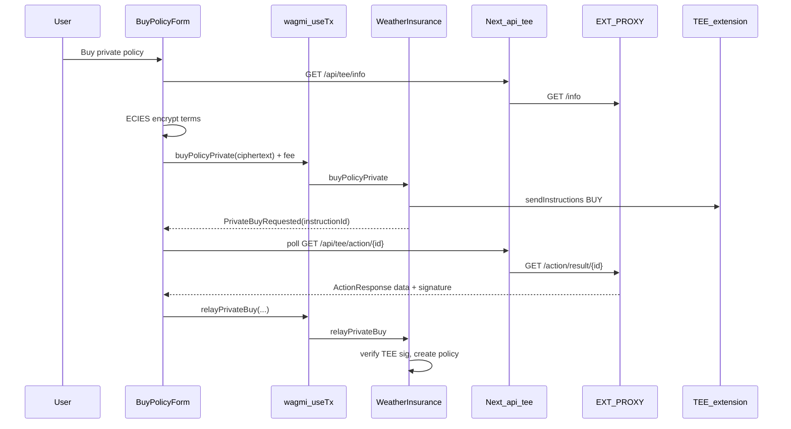

# Frontend private buy and `relayPrivateBuy`

How the Next.js dApp calls `relayPrivateBuy` when a user buys a **private** policy.

## ECIES and Flare Confidential Compute (FCC)

**ECIES** (Elliptic Curve Integrated Encryption Scheme) encrypts data so only the holder of a matching private key can decrypt it. It builds on [elliptic-curve cryptography](https://en.wikipedia.org/wiki/Elliptic-curve_cryptography): the client uses the TEE’s secp256k1 **public** key to produce ciphertext; only the TEE node’s **private** key can recover the plaintext.

In this extension’s private-buy path:

1. **Publish key** — The extension proxy exposes the TEE machine public key via `GET /info` (`machineData.publicKey`).
2. **Encrypt off-chain** — The dApp (or CLI) ABI-encodes `PrivateBuyParams`, then ECIES-encrypts that blob under the TEE public key.
3. **Submit ciphertext on-chain** — `buyPolicyPrivate` stores only the ciphertext in a `WEATHER` / `BUY` instruction. Observers see an opaque blob, not location, thresholds, or payout terms.
4. **Decrypt inside the TEE** — The extension receives the instruction in FCC, forwards the ciphertext to the local tee-node `POST /decrypt`, and gets plaintext back without the private key leaving the enclave.
5. **Validate and sign** — The extension checks the decrypted params, ABI-packs them into `ActionResult.Data`, and the proxy signs the result hash.
6. **Relay on-chain** — The policy holder calls `relayPrivateBuy` with the signed result. The contract verifies the TEE signature and creates the policy; premium still moves via ERC-20 as in the public path.

So ECIES keeps policy **terms** private on-chain; the TEE still **attests** to the decoded terms via its ECDSA signature on `relayPrivateBuy`.

## Entry point

Private buy is triggered from [`frontend/components/BuyPolicyForm.tsx`](../frontend/components/BuyPolicyForm.tsx) when the user clicks **Buy private policy** (`mode === "private"`, the default). The form calls [`requestAndRelayPrivateBuy`](../frontend/lib/tee/private-buy.ts), which mirrors Go `RequestAndRelayPrivateBuy`. The form is rendered on [`frontend/app/page.tsx`](../frontend/app/page.tsx).

**Public** mode (`buyPolicy`) never calls `relayPrivateBuy`.

## End-to-end flow



## Step-by-step (private path only)

### 0. Prerequisites

- Wallet connected (`useAccount`).
- If ERC-20 allowance &lt; `premium + payout`, user **Approve WPT** (`approve` on pay token → `WEATHER_INSURANCE_ADDRESS`).
- **Payout pool** must cover the policy: `payout ≤ availableLiquidity + premium` at `relayPrivateBuy` (see `_createPolicy` in [`InstructionSender.sol`](../contracts/InstructionSender.sol)). Fund via **Payout pool → Fund pool** in the UI or `bash ./scripts/test.sh` (deposits 10 WPT).
- `ensureReady()` runs contract setup checks ([`ContractSetup`](../frontend/components/ContractSetup.tsx)).

### 1. TEE public key

`fetchTeeInfo()` → browser `GET /api/tee/info` → [`frontend/app/api/tee/info/route.ts`](../frontend/app/api/tee/info/route.ts) → `proxyGet("/info")` on `EXT_PROXY_URL` / `EXT_PROXY_LOCAL_URL` ([`frontend/lib/server/tee-proxy.ts`](../frontend/lib/server/tee-proxy.ts)).

Uses `info.machineData.publicKey` for ECIES (see [ECIES and FCC](#ecies-and-flare-confidential-compute-fcc) above).

### 2. Encrypt policy terms (client-side)

[`frontend/lib/tee/ecies.ts`](../frontend/lib/tee/ecies.ts) ABI-encodes:

`(holder, contractAddr, date, rainThresholdMmE2, payout, premium, lat, lon)`

where `lat` / `lon` are decimal strings from geocoding the user’s City,CC query (`GET /api/geocode`). The plaintext is then ECIES-encrypted with the TEE machine secp256k1 public key (`ecies-geth`).

### 3. Submit instruction on-chain (`buyPolicyPrivate`)

[`useTx`](../frontend/lib/hooks/useTx.ts): `writeContractAsync` + `waitForTransactionReceipt` (wagmi/viem).

- Target: `NEXT_PUBLIC_WEATHER_INSURANCE`
- Args: `[ciphertext]`
- `value`: `NEXT_PUBLIC_INSTRUCTION_FEE_WEI`

Contract [`buyPolicyPrivate`](../contracts/InstructionSender.sol) sends a `WEATHER` / `BUY` instruction and emits `PrivateBuyRequested(instructionId, msg.sender)`.

### 4. Parse instruction ID from receipt

[`frontend/lib/tee/instruction.ts`](../frontend/lib/tee/instruction.ts) decodes `PrivateBuyRequested` (or falls back to topic parsing).

### 5. Poll TEE result (off-chain)

`pollActionResult(instructionId)` → `GET /api/tee/action/{id}` ([`frontend/app/api/tee/action/[id]/route.ts`](../frontend/app/api/tee/action/[id]/route.ts)): up to 15 attempts, 2s apart, proxying `GET /action/result/{id}`.

Response: [`ActionResponse`](../frontend/lib/tee/types.ts) — `result.data`, `result.id`, `result.submissionTag`, `result.status`, and `signature`.

TEE extension [`processWeatherBuy`](../internal/extension/extension.go) decrypts ciphertext, validates params, ABI-packs the tuple into `ActionResult.Data`, sets status `1`, and the proxy signs `ActionResult.Hash()`.

### 6. `relayPrivateBuy` (wallet transaction)

Implemented in [`frontend/lib/tee/private-buy.ts`](../frontend/lib/tee/private-buy.ts):

```typescript
await execute({
  address: contractAddr,
  abi: weatherInsuranceAbi,
  functionName: "relayPrivateBuy",
  args: [data, actionId, submissionTag, status, signature],
});
```

| Contract arg | Proxy / response field |
|--------------|------------------------|
| `_resultData` | `result.data` |
| `_actionId` | `result.id` |
| `_submissionTag` | `result.submissionTag` |
| `_status` | `result.status` (must be `1`) |
| `_signature` | `signature` |

[`actionResultFields`](../frontend/lib/tee/proxy.ts) maps the JSON into these args.

### 7. On-chain `relayPrivateBuy`

[`contracts/InstructionSender.sol`](../contracts/InstructionSender.sol):

1. Requires `_status == 1`.
2. Rebuilds result hash: `keccak256(abi.encodePacked(keccak256(_resultData), _actionId, keccak256(bytes(_submissionTag)), _status))`, EIP-191 personal sign, recovers signer → must equal `teeAddress`.
3. `abi.decode(_resultData, (holder, contractAddr, date, rainThresholdMmE2, payout, premium, lat, lon))`.
4. `require(msg.sender == holder)` — connected wallet must be the holder in the TEE result.
5. Creates private policy with `termsCommitment`, emits `PrivatePolicyRelayed`.

Premium must already be approved on the pay token.

## What does not call `relayPrivateBuy`

- **Public buy** in `BuyPolicyForm`: `buyPolicy` only.
- **Settlement / weather** in `PolicyList` / `LiveWeather`: poll action results but call `settle` or decode FETCH data.
- **CLI**: [`tools/pkg/utils/instructions.go`](../tools/pkg/utils/instructions.go) `RequestAndRelayPrivateBuy` uses the same five arguments.

## Configuration

| Variable | Role |
|----------|------|
| `NEXT_PUBLIC_WEATHER_INSURANCE` | Contract for all writes |
| `NEXT_PUBLIC_PAY_TOKEN` | ERC-20 approve / premiums |
| `NEXT_PUBLIC_INSTRUCTION_FEE_WEI` | `buyPolicyPrivate` / settlement msg.value |
| `EXT_PROXY_URL` / `EXT_PROXY_LOCAL_URL` | Server-side proxy for `/info` and `/action/result` |

TEE extension must be running; contract `teeAddress` must be set (`extension-post-setup.sh`).

## See also

- [frontend-weather-fetch.md](frontend-weather-fetch.md) — `getWeather` + poll + decode flow
- [testing.md](testing.md) — Go `run-test` private buy and Solidity unit tests
- [DEPLOYMENT_STEPS.md](../DEPLOYMENT_STEPS.md) — local stack and ngrok
